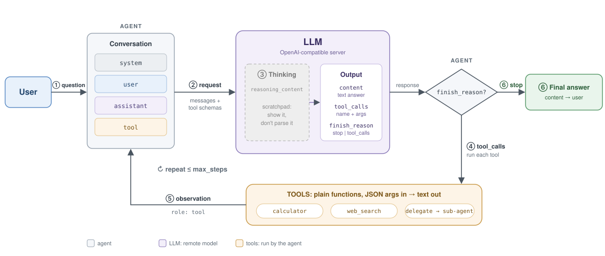
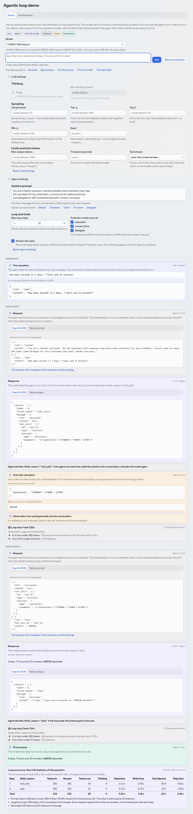

# How does an agentic loop work? 

A minimal agent harness in Java, with a Vaadin UI on top. Ask a question and watch
the agentic loop run step by step: the request, the model's tool call, your code running
the tool, the observation going back into the conversation, and the final answer.

The LLM runs **inside the JVM** with [Quixotic jinfer](https://qxotic.ai): no
server, no API key, no Spring AI. The harness calls jinfer's `ChatEngine` directly.
With an API key set, the models of an OpenAI-compatible API (OpenAI, x.ai, a llama.cpp
server, …) are offered too; see [Models behind an API](#models-behind-an-api).



Other write-ups call this loop Perceive → Reason → Act → Observe: here that's ② request →
③ thinking and the response → ④ tool calls → ⑤ observation. There's no separate "reflect" step:
the model reflects by reading the tool result in the next request.

The demo after one question, with the **LLM settings** and **Agent settings** panels open
(taken with the [scripted model](#where-things-are)):



## Requirements

- Java 25 **with the `jdk.incubator.vector` module** (standard OpenJDK / Temurin 25
  builds have it; some JRE and JetBrains Runtime builds don't). Check with
  `java --list-modules | grep incubator.vector`.
- About 1 GB of disk and RAM for the default model.

## Run

```sh
mvn spring-boot:run
```

Then open <http://localhost:8080>. The run configuration adds the JVM flags jinfer
needs: `--add-modules=jdk.incubator.vector --enable-native-access=ALL-UNNAMED`.

On first start the default model (`LiquidAI/LFM2.5-1.2B-Instruct-GGUF:Q4_K_M`, ~0.7 GB)
downloads from Hugging Face into the jinfer model cache (`~/.cache/jinfer/models`
on Linux, `~/Library/Caches/jinfer/models` on macOS). The page shows a status line
until it has loaded. Later starts reuse the cached file.

- Move the model cache: set `JINFER_MODELS`. Stay offline: set `JINFER_OFFLINE=1`.

## Choosing a model

Pick a model in the **Model** selector above the chat box. Small models are fast on
a CPU but vary a lot in how reliably they call tools. These four are supported by
jinfer 0.3.1 and are good at tool calling for their size (BFCL v3 is the vendors' own
function-calling benchmark score):

| Model | Size | BFCL v3 | Thinking | Notes |
|-------|------|---------|----------|-------|
| LFM2.5 1.2B Instruct (default) | 0.7 GB | 49.1 | no | fastest; built for on-device use |
| MiniCPM5 1B | 0.7 GB | – | optional | turn on **Think** to see it reason |
| LFM2.5 1.2B Thinking | 0.7 GB | – | always | reasons before every answer or tool call |
| Qwen3.5 2B | 1.3 GB | – | optional | slowest; turn on **Think** to see it reason |

Only one model is in memory at a time: switching frees the current one and loads
the new one in the background (the first use of a model downloads it). The selected
model is shared by everyone using the app, and switching starts a new conversation.
The list lives in `ModelService.OPTIONS`.

Granite 4.0 1B scores best on tool calling at this size (BFCL v3 54.8), but jinfer 0.3.1
can't load its GGUF files: they store `granite.attention.head_count_kv` per layer, and
jinfer expects a single number. Granite 4.1 and 4.2 store a single number and do load,
but their smallest size is 3B (2.1 GB), e.g. `ibm-granite/granite-4.2-3b-GGUF:Q4_K_M`.

To start with another model, or one that isn't in the list (a Hugging Face
`owner/repo:QUANT` reference or a path to a `.gguf` file), set `AGENT_MODEL`:

```sh
AGENT_MODEL=ibm-granite/granite-4.2-3b-GGUF:Q4_K_M mvn spring-boot:run
```

The LFM2, Llama (incl. MiniCPM5 and Granite) and Qwen3.5 families are on the classpath; other model
families also need their `jinfer-<family>` dependency.

### Models behind an API

Set `OPENAI_API_KEY` and the **Model** selector also lists models of an OpenAI-compatible API,
called over HTTP with `POST /chat/completions` (`OpenAiLlm.java`). Without a key, nothing changes.

```sh
OPENAI_API_KEY=sk-… OPENAI_MODELS=gpt-5-mini mvn spring-boot:run
OPENAI_API_KEY=xai-… OPENAI_BASE_URL=https://api.x.ai/v1 OPENAI_MODELS=grok-4-fast mvn spring-boot:run
OPENAI_API_KEY=none OPENAI_BASE_URL=http://localhost:8081/v1 mvn spring-boot:run   # llama-server
```

| Variable | Default | |
|----------|---------|---|
| `OPENAI_API_KEY` | – | sent as `Authorization: Bearer …`; any value works for a server that needs none |
| `OPENAI_BASE_URL` | `https://api.openai.com/v1` | the API root |
| `OPENAI_MODELS` | – | comma-separated model ids; empty lists every model the API returns at `GET /models` |

The request is exactly the OpenAI JSON shown in the request card. The API applies the chat
template and parses the output on its server, so the **Native prompt / output** tabs stay empty.
`top_k`, `min_p` and Think (`chat_template_kwargs`) are llama.cpp / vLLM extensions: leave them
empty for OpenAI or x.ai, which reject unknown fields. Some OpenAI models also reject
`temperature` or `max_tokens`; the error card shows the API's reply.

**Think** (in LLM settings) lets the model reason before each step, shown as its own
Thinking card. It is enabled only for models with an optional thinking mode, and
it makes every step much slower: the model often writes hundreds of thinking
tokens before calling a tool. A model that always thinks shows Think checked and
locked.

## LLM settings and Agent settings

Two collapsed panels below the question box tune this browser tab, from the next question on.
**LLM settings** are sent to the model with every request (thinking, sampling, limits, tool
choice); **Agent settings** are what your code does (system prompt, loop, tools, streaming).
Each panel has its own reset button.

- **Agent:** the system prompt, the maximum number of loop steps, and which tools the model may
  call. An edited system prompt replaces the first message of the running conversation; the
  system prompt is just a message. The next request then can't reuse the prompt cache, so it's
  slower.
- **System prompt presets:** five buttons under the system prompt replace it (and enable all
  tools): **Default**; **Calculator** (forbids mental arithmetic); **Clock** (doesn't know the
  time, so `current_time` once per place); **Two tools** (plans `current_time` and calculator
  calls together); **Delegate** (a coordinator that hands side tasks to sub-agents). Sub-agents
  always get their own short worker prompt, since the main prompt may tell the model to
  delegate, which a sub-agent can't.
- **Example questions:** the buttons under the question box fill in a question and nothing
  else. Each one's tooltip names the system prompt it works best with, e.g. "Two time zones"
  with **Clock**.
- **Streaming:** on by default, so thinking and answer text appear token by token. Off, nothing
  appears until the reply is complete, which is how a plain request/response API call behaves.
  The model generates the same either way; the request JSON shows it as `"stream"`.
- **Thinking:** Think, and a cap on thinking tokens (for models that can think).
- **Sampling:** temperature, top-p, top-k, min-p and seed. Empty fields use the model's
  recommended values, shown as placeholders.
- **Limits and tool choice:** max output tokens, a timeout, and `tool_choice` (auto, required,
  or one specific tool). A forced tool choice applies to loop step 1 only, since a model forced
  to call a tool on every step could never answer.

Each request card lists the settings that differ from the model's defaults, and its OpenAI JSON
shows them as the usual fields (`temperature`, `top_p`, `max_tokens`, `seed`, `tool_choice`;
`top_k`, `min_p` and `chat_template_kwargs` are llama.cpp / vLLM extensions).

### Speed

Every model step logs one line, so you can compare models and settings:

```
LFM2.5-1.2B-Instruct-Q4_K_M.gguf: prompt 412 tok (380 cached) in 0.21 s · generated 37 tok (0 thinking) at 41.3 tok/s
```

- Q4 quantizations are about twice as fast as Q8 on a CPU (half the bytes per token).
- Leave Think off unless you want to show the reasoning.
- jinfer uses the physical cores by default. On Apple Silicon, also using the
  efficiency cores can help (+~10%). Set the thread count together with the
  required flags:

  ```sh
  mvn spring-boot:run -Djinfer.jvm.args="--add-modules=jdk.incubator.vector --enable-native-access=ALL-UNNAMED -Djinfer.threads=10"
  ```

## Tests

Run `mvn test`. The tests use a scripted fake LLM, so they need no model and no
Vector API.

## Where things are

Everything about the loop is in `src/main/java/com/example/agentdemo/harness/`:

| File                | Concept from the guide                                         |
|---------------------|----------------------------------------------------------------|
| `Agent.java`        | **The loop**: Thought → Tool call → Observation                |
| `Llm.java`          | The LLM as the loop sees it: conversation + tools in, reply out |
| `JinferLlm.java`    | The LLM, running in this JVM: jinfer `ChatEngine`, streaming   |
| `OpenAiLlm.java`    | The LLM, behind an OpenAI-compatible HTTP API: JSON + server-sent events |
| `ChatResponse.java` | `finish_reason`, `content`, `reasoning`, `tool_calls`          |
| `Tool.java`         | name + description + JSON Schema + function                   |
| `Tools.java`        | example tools: `calculator`, `current_time`, `delegate` (sub-agent) |

Messages are jinfer's own `Message` / `Content` types. There are four roles
(system, user, assistant, tool), exactly as in the guide. Tool call arguments
arrive as a `Map`, so there's no JSON string to decode.

`ModelService.java` loads the model in the background at startup.

The UI is in `src/main/java/com/example/agentdemo/ui/`:

- **Demo** (`demo/DemoView.java`): ask a question, then follow the loop in chronological order:
  ① question → ② request → ③ thinking → response → the agent's decision → ④ tool call →
  ⑤ observation → … → ⑥ final answer, then a **loop summary** with the LLM statistics of
  every step (tokens in, reused and out, thinking tokens, read and write times, tokens/s)
  and their totals. The colors and numbers match the architecture diagram
  (`LoopRole.java`, `LoopStage.java`). Hover or tab to a number to see that step in the
  diagram, with the other parts dimmed and a link to its explanation in the Architecture tab. Every request and response shows the data that
  moved, exactly as it is, in two tabs:
  - **OpenAI JSON**: the same data in the OpenAI Chat Completions shape most developers
    know (`wire/OpenAiJson.java`). For a model in this JVM nothing is sent over HTTP; for a
    model behind an API this is the request body that is sent.
  - **Native prompt / output**: the exact text the model reads and writes, special tokens
    included, e.g. LFM2.5's `<|tool_call_start|>[calculator(expression="…")]<|tool_call_end|>`.

  Requests show only what's new since the previous call; the full request is one click away.
- **Architecture** (`architecture/ArchitectureView.java`): the diagram from
  `docs/agentic-loop.svg` (the same file as in this README, copied into the app by the build), the steps explained,
  and how tool calls look natively and in the common APIs.

Each part of the screen is its own component, named after what it shows:

| Component | What it is |
|-----------|------------|
| `demo/ModelPicker`, `demo/QuestionBox`, `demo/RoleLegend` | the model selector, the question field, the color legend |
| `demo/settings/LlmSettingsPanel`, `AgentSettingsPanel` | the two settings panels |
| `demo/PresetBar` with `demo/QuestionPreset`, `demo/settings/SystemPromptPreset` | the example questions under the question box and the system prompt presets |
| `demo/timeline/Timeline` → `QuestionRun` → `LoopStepSection` | the conversation, one question, one loop step |
| `demo/timeline/cards/StageBadge`, `StageOverview`, `ui/LoopDiagram` | the ①–⑥ number, its popover, and the inline diagram that dims all but one step (`data-stages` groups in `docs/agentic-loop.svg`) |
| `demo/timeline/cards/*Card` | one card per event: `QuestionCard`, `RequestCard`, `ThinkingCard`, `ResponseCard`, `DecisionCard`, `ToolCallCard`, `ObservationCard`, `StepStatsCard`, `FinalAnswerCard`, `ErrorCard`, `LoopSummaryCard` |

`QuestionRun` is the `Agent.Listener`: it receives the loop's events on the agent's thread and
adds the matching cards in the browser. The model state (`ModelService.state()`) and whether a
question is running are signals; the controls bind to them.

To look at the UI without a model (no download, no Vector API needed), run it with a
scripted model from the test classpath:

```sh
mvn spring-boot:test-run -Dspring-boot.run.main-class=com.example.agentdemo.ScriptedDemoApplication \
    -Djinfer.jvm.args=--enable-native-access=ALL-UNNAMED
```

Its native text imitates LFM2.5's chat format; it doesn't come from a real model.

## Credits

The original idea and inspiration for this app come from Martin Vysny's
[agentic-loop-demo](https://codeberg.org/mvysny/agentic-loop-demo).
